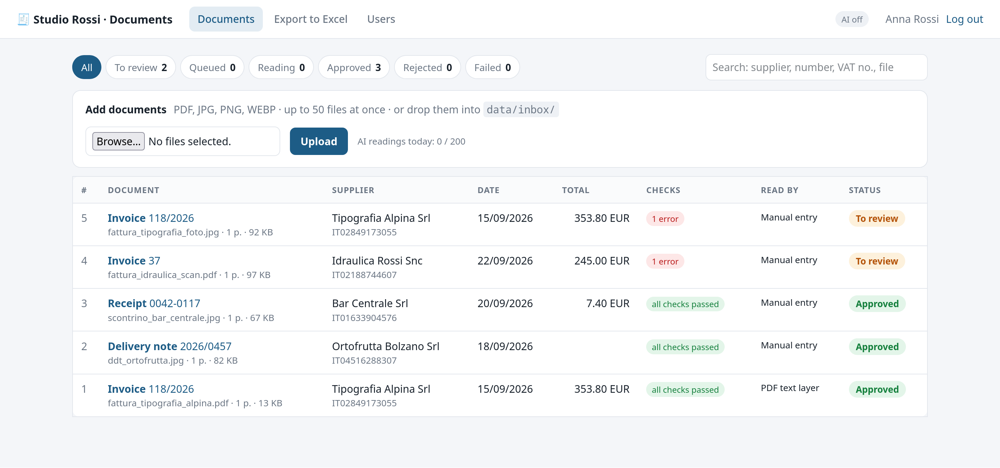
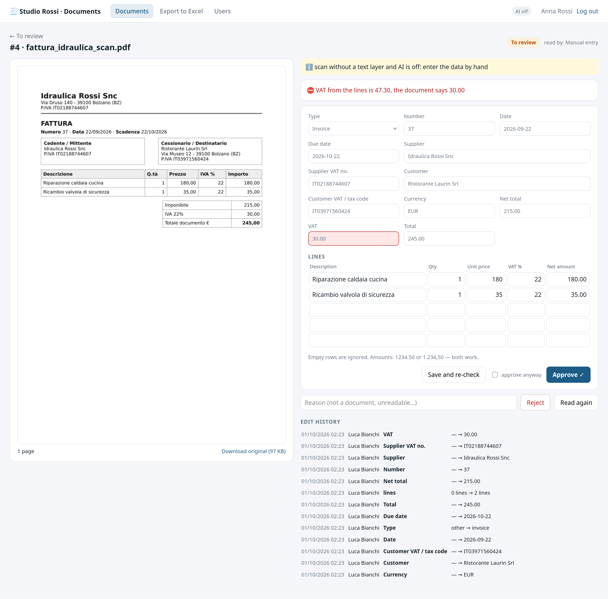
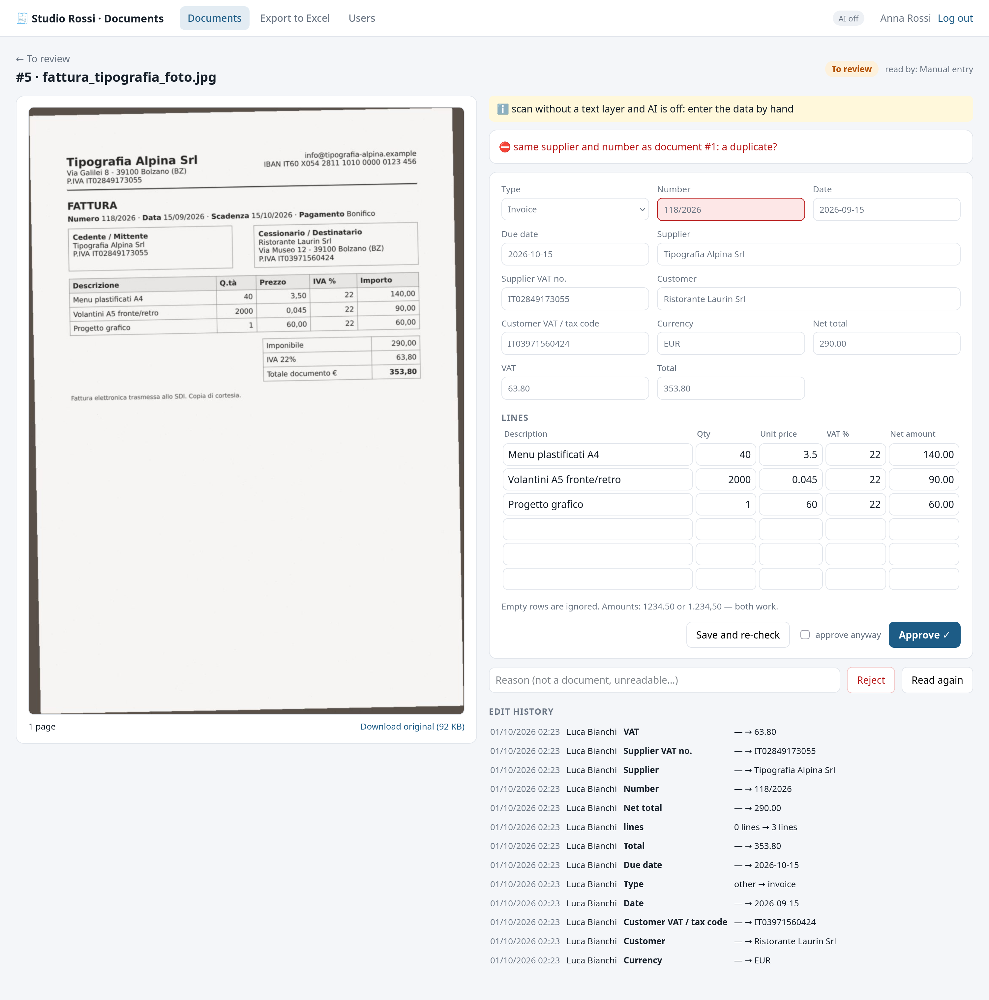
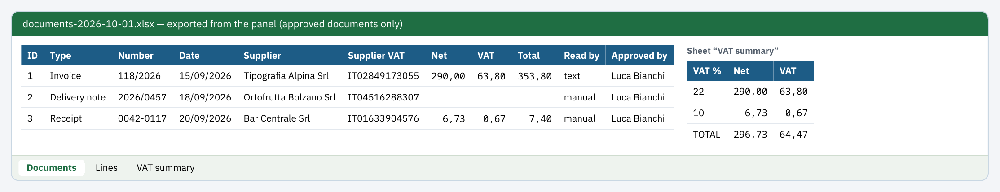

# 🧾 Doc Intake

<p>
  <a href="https://github.com/sonoyumi/doc-intake/actions/workflows/ci.yml"></a>
  
  
  
  
  
</p>

**🇬🇧 [English](#en)** · **🇮🇹 [Italiano](#it)** · **🇺🇦 [Українська](#uk)** · **🇷🇺 [Русский](#ru)**

<p align="center">
  
</p>
<p align="center">
  
  
</p>
<p align="center">
  
</p>

---

<a id="en"></a>

## 🇬🇧 English

Paper and PDF invoices, receipts and delivery notes become checked data in Excel. Drop files into the panel (or a
folder), Claude reads scans and phone photos into fields, rules check every total, VAT amount and Italian VAT
number, and a person looks at the document next to the fields, fixes what is wrong and approves it. Only approved
documents go to the Excel export for the accountant.

```
PDF · JPG · PNG ──► upload / data/inbox ──► type by content, size and page limits, SHA-256 dedupe
                                                │
                       queue (SQLite, lease) ◄──┘        PDF with a text layer ─► patterns, no AI
                                │                        scan / photo ─► Claude (page images → JSON schema)
                                ▼                        no AI / daily limit reached ─► manual entry
     checks: totals · VAT by lines · VAT numbers · dates · same supplier + number = duplicate
                                ▼
     review panel: image │ fields (errors highlighted) → save & re-check → approve / reject   (edit log)
                                ▼
     Excel: Documents · Lines · VAT summary  (numbers as numbers, dates as dates, no formulas from documents)
```

### Features

- **Any source:** upload up to 50 files at once or drop them into `data/inbox/` (a scanner, a shared folder, an e-mail
  rule). The type is detected from the content, never from the name; size and page limits; the same file twice is
  one document.
- **Reading:** Claude gets the page images and must answer in a JSON schema (structured outputs), so every field is
  always there; fields it was unsure about are marked. PDFs with a text layer are read by patterns, free and offline.
  The document is treated as data: text inside it cannot give the AI orders.
- **Checks on every reading, AI or human:** lines add up to the net, net + VAT = total, VAT recalculated from the lines,
  Italian VAT numbers (check digit) and tax codes, real dates, due date after the date, Italian VAT rates; receipts
  with VAT-inclusive prices and delivery notes without prices are understood.
- **Duplicates:** the same supplier and number as another document is flagged, even from a different file (a photo of
  an invoice that already arrived as PDF).
- **Review panel:** the page image next to the form, errors highlighted in the fields, typed amounts in either format
  (`1.234,50` or `1234.50`), approve, «approve anyway» for consciously accepted errors, reject with a reason, read
  again, edit history with who changed what.
- **Never stuck:** a temporary API error is retried with a growing pause; a permanent one (bad key) or the daily AI
  limit leads to the text layer or manual entry with a note — the document still reaches a person. A lease returns
  documents of a crashed worker to the queue.
- **Cost control:** `AI_DAILY_LIMIT` documents per day, counted atomically in the database.
- **Excel export:** approved documents, their lines and a VAT summary by rate; money as numbers, dates as dates;
  text that starts with `=` stays text.
- **Security:** scrypt passwords, signed session cookie, CSRF tokens, login attempts limit, strict CSP, files served
  only to logged-in users, roles (admin / reviewer).

### Example

```bash
doc-intake read examples/documents/fattura_tipografia_alpina.pdf      # AI_MODE=off: the PDF text layer
```

```
{
  "doc_type": "invoice",
  "number": "118/2026",
  "date": "2026-09-15",
  "supplier_vat": "IT02849173055",
  "net_total": "290.00",
  "vat_total": "63.80",
  "gross_total": "353.80",
  "lines": [ … 3 lines … ],
  …
}

Read by: text — read from the PDF text layer without AI: compare every field with the image
All checks passed.
```

Real output (shortened). The screenshots above come from a live run of the panel with the five sample documents in
`examples/documents/` (all fictional): the PDF was read without AI; the scans and photos were typed in the review
form as a person does with `AI_MODE=off`; the checks caught the plumber's VAT printed as 30,00 instead of 47,30 and
the photo of an invoice that was already entered. With `AI_MODE=claude` the same scans are read by Claude.

### Quick start

```bash
git clone https://github.com/sonoyumi/doc-intake.git
cd doc-intake
python3 -m venv .venv && source .venv/bin/activate
pip install -e ".[dev]"
cp .env.example .env                       # SECRET_KEY; AI_MODE=claude + ANTHROPIC_API_KEY to read scans
doc-intake add-user --email you@company.it --name "Your Name" --role admin
doc-intake import examples/documents       # or upload in the panel
doc-intake serve                           # panel + reading on http://127.0.0.1:8097
```

Other commands: `doc-intake worker` (reading in a separate process), `read FILE`, `export -o report.xlsx`, `stats`.
Docker: `docker build -t doc-intake . && docker run -p 8097:8097 --env-file .env -v $PWD/data:/app/data doc-intake`.

Tests: `pytest` (50 tests: file types and limits, PDF text layer and previews, the Claude request and every kind of
API error with a fake client, all the checks, VAT summary, the queue with leases, retries and the daily limit,
duplicates, the inbox folder, and the panel end to end: login limits, CSRF, upload, review, approve, export). No
network and no API key needed.

### Project structure

```
src/doc_intake/
├── config.py    # settings from .env, every error at once
├── files.py     # type by content, limits, storage by SHA-256, PDF text layer, previews, images for the AI
├── model.py     # the document shape, JSON schema for Claude, numbers and dates normalised
├── extract.py   # Claude reader (structured outputs) and the text-layer reader
├── checks.py    # totals, VAT, VAT numbers, dates
├── store.py     # SQLite: documents and their life cycle, edit log, users, daily AI budget
├── worker.py    # queue and inbox folder: read, check, retry, fall back
├── export.py    # Excel: Documents, Lines, VAT summary
├── web.py       # review panel: FastAPI + Jinja2
└── cli.py       # add-user | serve | worker | import | read | export | stats
examples/        # 5 fictional sample documents and the script that builds them
```

### Author

**Vladyslav Shokun** ([@sonoyumi](https://github.com/sonoyumi)), Python developer: Telegram bots, web scraping, automation.

[](https://t.me/sonoyumiii)
[](mailto:sonoyumiii@gmail.com)
[](https://www.linkedin.com/in/vladyslav-shokun/)

> 💼 Still typing invoices and receipts into spreadsheets by hand? I'll set up document intake like this for your office.

### License

MIT, see [LICENSE](LICENSE).

---

<a id="it"></a>

## 🇮🇹 Italiano

**[🇬🇧 English](#en)** · **🇮🇹 Italiano** · **[🇺🇦 Українська](#uk)** · **[🇷🇺 Русский](#ru)**

Fatture, scontrini e DDT su carta o in PDF diventano dati controllati in Excel. Caricate i file nel pannello (o in una
cartella), Claude legge scansioni e foto dal telefono, le regole verificano ogni totale, l'IVA e la partita IVA, e una
persona confronta il documento con i campi, corregge e approva. In Excel per il commercialista vanno solo i documenti
approvati.

### Funzionalità

- **Qualsiasi fonte:** fino a 50 file per volta dal pannello oppure nella cartella `data/inbox/` (scanner, cartella
  condivisa, regola della posta). Il tipo si riconosce dal contenuto, non dal nome; limiti di dimensione e pagine;
  lo stesso file due volte è un solo documento.
- **Lettura:** Claude riceve le immagini delle pagine e risponde secondo uno schema JSON (structured outputs): ogni
  campo c'è sempre, quelli incerti sono segnalati. I PDF con testo si leggono con dei pattern, gratis e offline. Il
  documento è un dato: il testo al suo interno non può dare ordini all'IA.
- **Controlli su ogni lettura, dell'IA o di una persona:** righe = imponibile, imponibile + IVA = totale, IVA ricalcolata
  dalle righe, partita IVA (cifra di controllo) e codice fiscale, date reali, scadenza dopo la data, aliquote italiane;
  scontrini con prezzi IVA inclusa e DDT senza prezzi vengono capiti.
- **Duplicati:** stesso fornitore e stesso numero di un altro documento = avviso, anche da un file diverso (la foto di
  una fattura già arrivata in PDF).
- **Pannello di verifica:** l'immagine accanto al modulo, errori evidenziati nei campi, importi in entrambi i formati
  (`1.234,50` o `1234.50`), approva, «approva comunque», rifiuta con motivo, rileggi, storico delle modifiche.
- **Mai bloccato:** un errore temporaneo dell'API si riprova con pause crescenti; uno permanente o il limite giornaliero
  dell'IA passano al testo del PDF o all'inserimento manuale con una nota.
- **Costi sotto controllo:** `AI_DAILY_LIMIT` documenti al giorno.
- **Export Excel:** documenti approvati, righe e riepilogo IVA per aliquota; importi come numeri, date come date; un
  testo che inizia con `=` resta testo.
- **Sicurezza:** password scrypt, cookie di sessione firmato, token CSRF, limite di tentativi di accesso, CSP rigorosa,
  file solo per utenti autenticati, ruoli (admin / revisore).

### Esempio

Gli screenshot in alto vengono da un'esecuzione reale con i cinque documenti di esempio in `examples/documents/` (tutti
inventati): il PDF letto senza IA, scansioni e foto inserite nel modulo; i controlli hanno trovato l'IVA dell'idraulico
stampata come 30,00 invece di 47,30 e la foto di una fattura già registrata. Con `AI_MODE=claude` le scansioni le
legge Claude.

### Avvio rapido

```bash
git clone https://github.com/sonoyumi/doc-intake.git
cd doc-intake
python3 -m venv .venv && source .venv/bin/activate
pip install -e ".[dev]"
cp .env.example .env                       # SECRET_KEY; AI_MODE=claude + ANTHROPIC_API_KEY per le scansioni
doc-intake add-user --email voi@azienda.it --name "Nome Cognome" --role admin
doc-intake serve                           # pannello su http://127.0.0.1:8097
```

Test: `pytest` (50 test, senza rete e senza chiave API).

### Struttura del progetto

Vedi la sezione inglese: `files.py` (file e limiti), `extract.py` (lettura), `checks.py` (controlli), `store.py`
(SQLite), `worker.py` (coda), `export.py` (Excel), `web.py` (pannello), `cli.py` (comandi).

### Autore

**Vladyslav Shokun** ([@sonoyumi](https://github.com/sonoyumi)), sviluppatore Python: bot Telegram, web scraping, automazione.

[](https://t.me/sonoyumiii)
[](mailto:sonoyumiii@gmail.com)
[](https://www.linkedin.com/in/vladyslav-shokun/)

> 💼 Copiate ancora a mano fatture e scontrini nei fogli Excel? Preparo un sistema come questo per il vostro ufficio.

### Licenza

MIT, vedi [LICENSE](LICENSE).

---

<a id="uk"></a>

## 🇺🇦 Українська

**[🇬🇧 English](#en)** · **[🇮🇹 Italiano](#it)** · **🇺🇦 Українська** · **[🇷🇺 Русский](#ru)**

Паперові та PDF-рахунки, чеки й накладні стають перевіреними даними в Excel. Файли завантажуються в панель (або в
папку), Claude читає скани й фото з телефона, правила перевіряють кожну суму, ПДВ та італійський податковий номер, а
людина звіряє документ із полями, виправляє й затверджує. В Excel для бухгалтера йдуть лише затверджені документи.

### Можливості

- **Будь-яке джерело:** до 50 файлів за раз у панелі або папка `data/inbox/` (сканер, спільна папка, правило пошти).
  Тип визначається за вмістом, не за назвою; ліміти розміру й сторінок; той самий файл двічі — один документ.
- **Читання:** Claude отримує зображення сторінок і відповідає за JSON-схемою (structured outputs) — усі поля завжди є,
  непевні позначено. PDF із текстовим шаром читаються шаблонами, безкоштовно й офлайн. Документ — це дані: текст у
  ньому не може віддавати команди ШІ.
- **Перевірки кожного читання, ШІ чи людини:** рядки = сума без ПДВ, сума + ПДВ = разом, ПДВ із рядків, італійський
  номер платника ПДВ (контрольна цифра) і codice fiscale, реальні дати, строк оплати після дати, ставки ПДВ Італії;
  чеки з цінами з ПДВ і накладні без цін розпізнаються правильно.
- **Дублікати:** той самий постачальник і номер, що в іншому документі, — попередження, навіть з іншого файлу.
- **Панель перевірки:** зображення поруч із формою, помилки підсвічено в полях, суми в будь-якому форматі, затвердити,
  «затвердити попри помилки», відхилити з причиною, прочитати знову, історія правок.
- **Ніколи не зависає:** тимчасова помилка API — повтор зі зростаючою паузою; постійна або денний ліміт ШІ — текстовий
  шар чи ручне введення з приміткою.
- **Контроль витрат:** `AI_DAILY_LIMIT` документів на день.
- **Експорт в Excel:** документи, рядки й зведення ПДВ за ставками; суми — числами, дати — датами; текст із `=` лишається
  текстом.
- **Безпека:** паролі scrypt, підписаний cookie сесії, CSRF-токени, ліміт спроб входу, сувора CSP, файли лише для
  авторизованих, ролі.

### Приклад

Скриншоти вгорі — зі справжнього запуску з п'ятьма вигаданими документами з `examples/documents/`: PDF прочитано без
ШІ, скани й фото введено у формі; перевірки знайшли ПДВ сантехніка, надрукований як 30,00 замість 47,30, і фото
рахунку, який уже внесено. З `AI_MODE=claude` скани читає Claude.

### Швидкий старт

```bash
git clone https://github.com/sonoyumi/doc-intake.git
cd doc-intake
python3 -m venv .venv && source .venv/bin/activate
pip install -e ".[dev]"
cp .env.example .env                       # SECRET_KEY; AI_MODE=claude + ANTHROPIC_API_KEY для сканів
doc-intake add-user --email you@company.it --name "Ім'я" --role admin
doc-intake serve                           # панель на http://127.0.0.1:8097
```

Тести: `pytest` (50 тестів, без мережі й ключа API).

### Структура проєкту

Див. англійський розділ: `files.py` (файли й ліміти), `extract.py` (читання), `checks.py` (перевірки), `store.py`
(SQLite), `worker.py` (черга), `export.py` (Excel), `web.py` (панель), `cli.py` (команди).

### Автор

**Vladyslav Shokun** ([@sonoyumi](https://github.com/sonoyumi)), Python-розробник: Telegram-боти, вебскрапінг, автоматизація.

[](https://t.me/sonoyumiii)
[](mailto:sonoyumiii@gmail.com)
[](https://www.linkedin.com/in/vladyslav-shokun/)

> 💼 Досі вручну переносите рахунки й чеки в таблиці? Налаштую такий приймач документів для вашого офісу.

### Ліцензія

MIT, див. [LICENSE](LICENSE).

---

<a id="ru"></a>

## 🇷🇺 Русский

**[🇬🇧 English](#en)** · **[🇮🇹 Italiano](#it)** · **[🇺🇦 Українська](#uk)** · **🇷🇺 Русский**

Бумажные и PDF-счета, чеки и накладные превращаются в проверенные данные в Excel. Файлы загружаются в панель (или в
папку), Claude читает сканы и фото с телефона, правила проверяют каждую сумму, НДС и итальянский налоговый номер, а
человек сверяет документ с полями, исправляет и утверждает. В Excel для бухгалтера попадают только утверждённые
документы.

### Возможности

- **Любой источник:** до 50 файлов за раз в панели или папка `data/inbox/` (сканер, общая папка, правило почты). Тип
  определяется по содержимому, а не по имени; лимиты размера и страниц; один и тот же файл дважды — один документ.
- **Чтение:** Claude получает изображения страниц и отвечает по JSON-схеме (structured outputs) — все поля есть всегда,
  сомнительные помечены. PDF с текстовым слоем читаются шаблонами, бесплатно и без сети. Документ — это данные: текст
  внутри него не может командовать ИИ.
- **Проверки любого чтения, ИИ или человека:** строки = сумма без НДС, сумма + НДС = итого, НДС по строкам, номер
  плательщика НДС Италии (контрольная цифра) и codice fiscale, настоящие даты, срок оплаты после даты, ставки НДС
  Италии; чеки с ценами с НДС и накладные без цен понимаются правильно.
- **Дубли:** тот же поставщик и номер, что у другого документа, — предупреждение, даже из другого файла.
- **Панель проверки:** изображение рядом с формой, ошибки подсвечены в полях, суммы в любом формате, утвердить,
  «утвердить несмотря на ошибки», отклонить с причиной, прочитать заново, журнал правок.
- **Никогда не зависает:** временная ошибка API — повтор с растущей паузой; постоянная или дневной лимит ИИ — текстовый
  слой или ручной ввод с пометкой.
- **Контроль расходов:** `AI_DAILY_LIMIT` документов в день.
- **Выгрузка в Excel:** документы, строки и сводка НДС по ставкам; суммы — числами, даты — датами; текст с `=` остаётся
  текстом.
- **Безопасность:** пароли scrypt, подписанный cookie сессии, CSRF-токены, лимит попыток входа, строгая CSP, файлы только
  для вошедших, роли.

### Пример

Скриншоты вверху — с настоящего запуска с пятью вымышленными документами из `examples/documents/`: PDF прочитан без
ИИ, сканы и фото введены в форме; проверки нашли НДС сантехника, напечатанный как 30,00 вместо 47,30, и фото счёта,
который уже внесён. С `AI_MODE=claude` сканы читает Claude.

### Быстрый старт

```bash
git clone https://github.com/sonoyumi/doc-intake.git
cd doc-intake
python3 -m venv .venv && source .venv/bin/activate
pip install -e ".[dev]"
cp .env.example .env                       # SECRET_KEY; AI_MODE=claude + ANTHROPIC_API_KEY для сканов
doc-intake add-user --email you@company.it --name "Имя" --role admin
doc-intake serve                           # панель на http://127.0.0.1:8097
```

Тесты: `pytest` (50 тестов, без сети и ключа API).

### Структура проекта

См. английский раздел: `files.py` (файлы и лимиты), `extract.py` (чтение), `checks.py` (проверки), `store.py`
(SQLite), `worker.py` (очередь), `export.py` (Excel), `web.py` (панель), `cli.py` (команды).

### Автор

**Vladyslav Shokun** ([@sonoyumi](https://github.com/sonoyumi)), Python-разработчик: Telegram-боты, веб-скрапинг, автоматизация.

[](https://t.me/sonoyumiii)
[](mailto:sonoyumiii@gmail.com)
[](https://www.linkedin.com/in/vladyslav-shokun/)

> 💼 Всё ещё вручную переносите счета и чеки в таблицы? Настрою такой приём документов для вашего офиса.

### Лицензия

MIT, см. [LICENSE](LICENSE).
